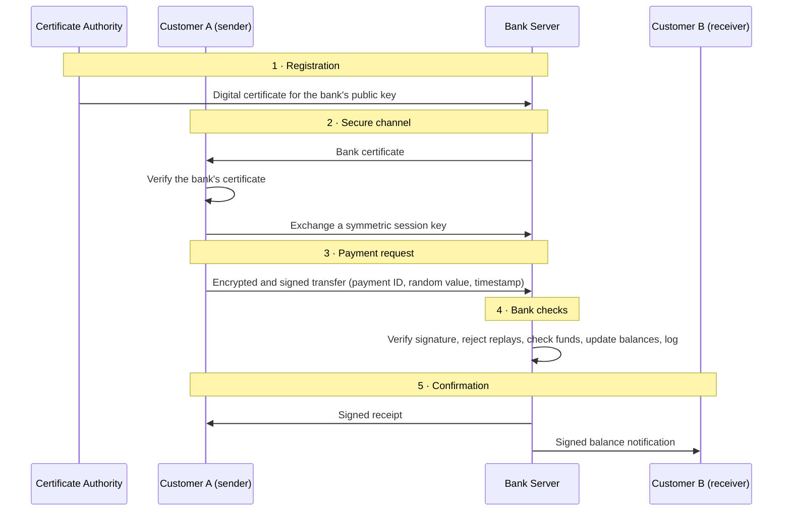

<div align="center">

# 🏦 Secure Digital Banking & Money Transfer System

**INSE 6110 — Foundations of Cryptography · Concordia University · Fall 2026**

A simple banking system where customers manage their accounts and transfer money to known recipients,
built to demonstrate how cryptography protects banking information and transfers.


</div>

---

## 📖 Scenario

> *Customer A logs in, checks their balance, then sends **$100** to Customer B.*

The system protects the confidentiality and integrity of banking information and transfers, verifies customer identity, and prevents unauthorized transactions. All accounts, balances and transactions are simulated.

## 🔐 How a transfer works



## 🧰 Cryptographic methods

| Security goal | Method |
|---|---|
| Confidentiality and integrity in transit | Authenticated symmetric encryption |
| Authenticate the bank, establish a session key | Public-key cryptography with a certificate |
| Authenticity and non-repudiation | Digital signatures on requests and receipts |
| Integrity checks | Hashing |
| Protection of stored account data | Encryption at rest |
| Replay protection | Unique payment IDs, timestamps and random values checked against stored records |

## 📁 Repository structure

```text
.
├── backend/    Python backend: cryptographic functions and APIs
└── frontend/   Web interface that uses the backend APIs
```

## 🤝 Working together

- `main` should always work, so don't push to it directly.
- Pull the latest `main` before starting new work.
- Create a branch for your task (e.g. `backend/transfers`, `frontend/login-page`), push it, and open a **Pull Request** into `main`.

## 👥 Team

| Member | Responsibility |
|---|---|
| Nadhem Rojbi | Report, presentation and demo |
| Novruz Amirov | GitHub repository and frontend |
| Muhammad Saleh | Backend |
| Ahsan Saleem | Testing and security analysis |

---

<sub>Academic prototype for INSE 6110. Simulated accounts only.</sub>
